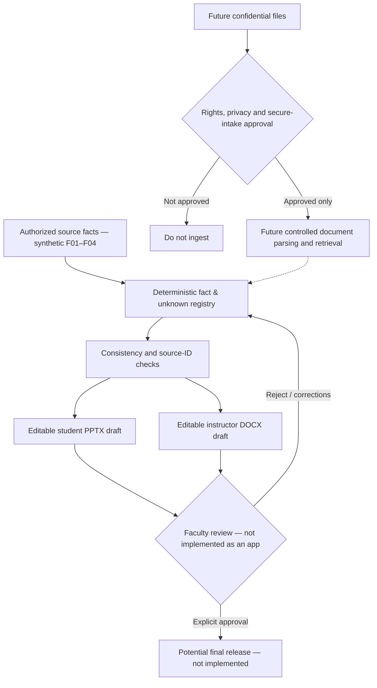

# Original synthetic faculty workflow — editable source-grounded draft proof

**Artifact:** [Download exact seven-file ZIP](https://media.base44.com/files/public/6a89094776dbb07b37c5ae96/0799c0ec3_OPS_Faculty_Workflow_Synthetic_Proof_v1.zip) · SHA-256 `1cf27d1c568fd902d6433beca0e5d42f232b71620f116d29d178b1c57e6a6c75`

**Purpose:** A bounded, self-directed technical demonstration for a potential faculty document-workflow buyer. **Not** a commissioned project, classroom adoption, published research, or evidence of a paid customer.

A fictional supply-chain case in `source_packet.json` (explicit source fact IDs F01–F04 and unknowns U01–U03) drives the included offline script to create **four editable PowerPoint student slides**, **a separate editable one-page Word instructor note**, a SHA-256 manifest and a standalone verifier. The result is labeled **DRAFT_PENDING_FACULTY_APPROVAL** throughout. The 96% carrier performance is clearly a forecast, not an observed outcome; missing business facts remain marked unknown.

**Verification completed October 31, 2026:** Actual PPTX/DOCX were inspected after rendering; final source-reference and arithmetic test passed; public ZIP fetched HTTP 200, 69,448 bytes, `application/zip`, exact SHA-256 match, seven expected members, ZIP CRC PASS.

**Limits, important for evaluating fit:** This is a deterministic script using structured synthetic input; it is **not** a RAG/embeddings system, not a secure faculty file intake, not integrated with university identity/provider systems, not a tested license or production deployment, and not a guarantee of teaching quality or faculty acceptance. No client/real student/private research data was ingested. Python code runs locally and depends on `python-pptx` and `python-docx`.

A production system would need a separately agreed discovery/architecture phase covering rights, sensitive-data policies, verified source registries/retrieval, approved hosted/local model routes, tests for unsupported claims, faculty review, editable exports, and secure owner handoff. No protected customer workflow is offered through this ZIP.

## Workflow boundary diagram

**Solid first path is demonstrated only with fictional structured source data.** All remaining gates are **proposed for discovery and buyer acceptance**; the ZIP does not implement institutional authentication, private file transfer, embeddings, or an approval UI.

**Decision boundaries:** The current code creates drafts and verifies source references; it cannot finalize a faculty judgment. A production owner must determine data residency, role-based access, third-party processor permissions, retrieval quality and supported export fidelity before admitting private material. An editable output is not evidence of accurate scholarship; all citations, claims, teaching quality and intellectual-property rights require review.

**Acceptance checks for a proposed paid pilot:** (1) one rights-cleared representative input, (2) exact source-to-claim traceability, (3) source-neutral handling of unknowns, (4) editable PPTX/DOCX, (5) student/instructor content separation, (6) explicit faculty approval before final status, (7) measured human time and revision effort, and (8) owner-accepted data-retention and handoff rules. Only checks (2)–(5) have bounded synthetic evidence today; (1) is satisfied by an invented dataset rather than client rights clearance, and (6) is a visible draft-state hold rather than a functioning approval workflow.

**Current commercial status:** Example only; application, quote, buyer review, contract, payment and revenue **not established**. Public readability does not imply a project-wide open-source license or permission to process confidential material.
